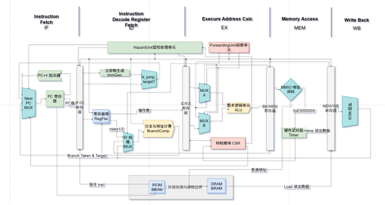
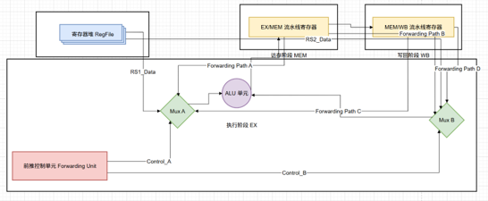
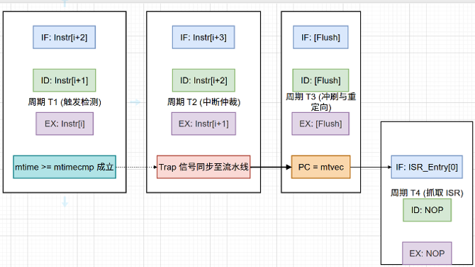

# 面向嵌入式实时应用的轻量化 RV32I 特权架构 CPU


本项目基于 Verilog / SystemVerilog 实现了一款面向嵌入式实时应用的轻量化 RV32I 处理器，并集成数字孪生 SoC 外设。CPU 采用经典五级流水线架构，支持数据前推、Load-Use 冒险处理、分支提前判决、机器模式 CSR、`ECALL` / `MRET` 异常处理、硬件定时器中断、UART 与数字孪生外设总线。仅供学习参考喵，不可用于竞赛和作业。（因为性能不是很好）

- **指令集**：RV32I 基础整数指令 + Zicsr 机器模式子集
- **微架构**：IF / ID / EX / MEM / WB 五级流水线
- **目标频率**：100 MHz
- **时序结果**：设计文档记录 WNS = **+0.111 ns**
- **开发环境**：Vivado 2023.2 + MounRiver Studio
- **设计语言**：Verilog / SystemVerilog

---

## 目录

- [项目概述](#项目概述)
- [主要特性](#主要特性)
- [系统架构](#系统架构)
- [五级流水线设计](#五级流水线设计)
- [数据通路模块](#数据通路模块)
- [流水线冒险处理](#流水线冒险处理)
- [特权架构与异常中断](#特权架构与异常中断)
- [硬件定时器与外设](#硬件定时器与外设)
- [性能优化](#性能优化)
- [指令支持](#指令支持)
- [工程结构](#工程结构)
- [快速开始](#快速开始)
- [仿真验证](#仿真验证)
- [设计文档与图片](#设计文档与图片)
- [说明](#说明)

---

## 项目概述

随着异构计算与特定领域架构的发展，基于开源指令集架构的处理器定制化设计成为 SoC 研究的重要方向。RISC-V 凭借模块化、可扩展和简洁的特性，为低功耗、高性能微架构提供了理想基础。

本项目面向 FPGA 竞赛与嵌入式实时应用场景，在有限的逻辑资源约束下完成了一款 RV32I 处理器的设计与实现，重点解决以下问题：

1. 如何通过五级流水线提高主频与指令吞吐率；
2. 如何通过数据前推和冒险控制减少流水线气泡；
3. 如何实现机器模式 CSR、异常与定时器中断；
4. 如何在 100 MHz 目标下实现时序收敛；
5. 如何完成 CPU 与数字孪生外设的软硬件协同验证。

项目最终实现了从 RTL 设计、仿真验证、Vivado 综合实现到 MounRiver Studio 裸机软件联调的完整流程。

---

## 主要特性

### 处理器核心

- 完整支持 RV32I 基础整数指令集，共 37 条基础操作指令
- 支持 `CSRRW`、`CSRRS`、`CSRRC` 及立即数形式 Zicsr 指令
- 支持 `ECALL` 环境调用与 `MRET` 异常返回
- 经典五级线性流水线：IF / ID / EX / MEM / WB
- 32 × 32 bit 通用寄存器堆，`x0` 恒为 0
- 独立指令存储器接口与数据/外设总线接口
- 哈佛存储架构
- 支持字节、半字、字加载与存储

### 流水线控制

- EX/MEM、MEM/WB 到 EX 的全通路数据前推
- ID 阶段分支比较与跳转提前判决
- Load-Use 冒险检测与单周期气泡插入
- 分支依赖冒险检测与流水线停顿
- 分支跳转与 Trap 触发时的流水线冲刷
- 前推优先级：MEM 阶段结果优先于 WB 阶段结果

### 特权与系统支持

- 机器模式 CSR：`mstatus`、`mtvec`、`mepc`、`mcause`
- 精确异常入口与现场保存
- `MRET` 恢复 `mstatus.MIE` 并返回 `mepc`
- 32 位硬件定时器 `mtime` / `mtimecmp`
- 定时器中断请求与全局中断使能门控
- 内存映射 I/O 外设接口

### SoC 与外设

- IROM / DRAM 存储接口
- UART 串口控制器
- 数码管显示驱动
- 外设桥接与地址译码
- 数字孪生控制器
- 板级顶层与验证测试平台

---
## 系统架构

本项目采用哈佛存储架构与五级线性流水线拓扑。CPU 顶层模块 `myCPU` 连接指令存储器 IROM 和外设总线，内部划分为取指、译码、执行、访存、写回五个解耦阶段。

<p align="center">
  
</p>

<p align="center"><b>图 1　CPU 整体架构图</b></p>

CPU 顶层主要接口如下：

| 信号 | 方向 | 位宽 | 说明 |
| --- | --- | --- | --- |
| `cpu_rst` | 输入 | 1 | CPU 复位信号，高电平有效 |
| `cpu_clk` | 输入 | 1 | CPU 时钟信号 |
| `irom_addr` | 输出 | 32 | 指令 ROM 读取地址，输出当前 PC |
| `irom_data` | 输入 | 32 | 指令 ROM 返回的指令数据 |
| `perip_addr` | 输出 | 32 | 外设总线地址 |
| `perip_wen` | 输出 | 1 | 外设总线写使能 |
| `perip_mask` | 输出 | 2 | 写掩码：00=字节，01=半字，10=字 |
| `perip_wdata` | 输出 | 32 | 外设总线写数据 |
| `perip_rdata` | 输入 | 32 | 外设总线读数据 |

复位后 PC 初始化为 `32'h8000_0000`，流水线各级状态清零。

---

## 五级流水线设计

CPU 将指令执行过程划分为五个阶段，并通过四组流水线寄存器进行时序解耦：

```text
IF ──► IF/ID ──► ID ──► ID/EX ──► EX ──► EX/MEM ──► MEM ──► MEM/WB ──► WB
```

<p align="center">
  
</p>

<p align="center"><b>图 2　CPU 内部五级流水线数据通路原理图</b></p>

### 各阶段功能

| 阶段 | 主要功能 |
| --- | --- |
| IF | 维护 PC，输出取指地址，接收 IROM 指令数据 |
| ID | 指令译码、读取寄存器堆、生成立即数、分支比较、CSR 读 |
| EX | ALU 运算、数据前推选择、CSR 写数据生成、异常与中断判断 |
| MEM | 数据存储器/外设访问、字节/半字/字写掩码处理 |
| WB | 选择 ALU 结果、Load 数据、PC+4 或 CSR 数据写回寄存器堆 |

### 流水线寄存器

| 流水线寄存器 | 主要保存内容 |
| --- | --- |
| IF/ID | `id_pc`、`id_inst` |
| ID/EX | `ex_pc`、`ex_rdata1`、`ex_rdata2`、`ex_imm`、`ex_rd`、`ex_rs1`、`ex_rs2`、`ex_opcode`、`ex_funct3`、`ex_funct7`、`ex_csr_addr`、`ex_csr_rdata` |
| EX/MEM | `mem_alu_result`、`mem_rdata2`、`mem_rd`、`mem_opcode`、`mem_funct3`、`mem_pc`、CSR 相关信号 |
| MEM/WB | `wb_alu_result`、`wb_rd`、`wb_opcode`、`wb_funct3`、`wb_pc`、`wb_csr_rdata`、`wb_mem_rdata` |

---

## 数据通路模块

### IF 取指模块

- 包含 PC 寄存器，用于生成下一条指令地址。
- 根据 `stall_if` 决定 PC 是否更新；`stall_if=1` 时保持当前 PC。
- PC 通过 `irom_addr` 输出到指令存储器，并通过 `irom_data` 接收指令。
- `flush_if` 有效时，将当前取到的指令替换为 NOP（`32'h00000013`）。

### ID 译码模块

- 通过 IF/ID 寄存器保存当前指令与 PC。
- 解析 `rs1`、`rs2`、`rd`、`opcode`、`funct3`、`funct7` 和 CSR 地址。
- 实例化寄存器堆、立即数生成器、分支比较器、CSR 读接口和前推单元。
- 根据 `id_branch_taken` 与 `trap_flush` 生成下一指令地址。
- 冒险控制单元产生 `stall_if`、`stall_id`、`flush_if`、`flush_ex`。

### EX 执行模块

- EX 阶段完成 ALU 运算、CSR 写数据生成和异常/中断判断。
- ALU 输入通过前推多路选择器选择寄存器值、MEM 前推值或 WB 前推值。
- 支持 `ECALL` 与定时器中断 `timer_irq` 的 Trap 判断。
- 定时器单元提供 `mtime` 与 `mtimecmp`，可通过 CSR 或 MMIO 访问。

### MEM 访存模块

- 从 `mem_alu_result` 获取访存地址 `perip_addr`。
- 支持字节、半字、字写操作，通过 `perip_mask` 和 `perip_wdata` 控制写掩码与数据复制。
- 特殊地址映射：
  - `0xE0000000`：读取 `mtime`
  - `0xE0000004`：读取 `mtimecmp`
- `perip_wen` 仅在 Store 指令时有效。

### WB 写回模块

- 根据指令类型选择写回数据：
  - Load：符号/零扩展后的存储器数据
  - JAL / JALR：`PC + 4`
  - CSR 指令：CSR 读值
  - 其他指令：ALU 结果
- 由 `wb_wen` 控制寄存器堆写使能，写回目标为 `wb_rd`。

### 主要子模块

| 模块 | 功能 |
| --- | --- |
| `ImmGen` | 将指令中的 I/S/B/U/J 型位段拼接并符号扩展为 32 位立即数 |
| `BranchComp` | 根据 `opcode`、`funct3` 和两个比较数判断分支是否成立 |
| `ALU` | 执行算术、逻辑、移位、比较等 RV32I 运算 |
| `RegFile` | 32 × 32 bit 通用寄存器堆，支持双端口读和同步写 |
| `ForwardingUnit` | 检测跨流水级 RAW 依赖并生成前推选择信号 |
| `HazardUnit` | 检测 Load-Use 与分支依赖，产生 Stall / Flush 信号 |
| `CSR_Reg` | 管理 `mstatus`、`mtvec`、`mepc`、`mcause` |
| `TimerUnit` | 维护 `mtime` / `mtimecmp` 并产生定时器中断 |

---
## 流水线冒险处理

### 数据冒险

当后级指令需要读取前级指令尚未写回的结果时，会发生 RAW（Read After Write）数据冒险。本项目采用前推优先、必要时停顿的策略。

<p align="center">
  
</p>

<p align="center"><b>图 3　RV32I 核心数据前推网络微架构拓扑图</b></p>

前推路径包括：

- EX/MEM → EX
- MEM/WB → EX
- ID 阶段分支比较操作数前推

前推优先级：

| 条件 | 数据来源 | 优先级 |
| --- | --- | --- |
| MEM 阶段写寄存器与 EX 源寄存器匹配 | MEM 阶段 ALU 结果 | 最高 |
| WB 阶段写寄存器与 EX 源寄存器匹配 | WB 阶段写回数据 | 次高 |
| 无冲突 | 寄存器堆原始读数据 | 默认 |

核心前推逻辑如下：

```verilog
assign forward_a = (mem_wen && (mem_rd == ex_rs1) && (ex_rs1 != 5'b0))
                    ? mem_alu_result :
                   (wb_wen && (wb_rd == ex_rs1) && (ex_rs1 != 5'b0))
                    ? wb_wdata : ex_rdata1;

assign forward_b_reg = (mem_wen && (mem_rd == ex_rs2) && (ex_rs2 != 5'b0))
                        ? mem_alu_result :
                       (wb_wen && (wb_rd == ex_rs2) && (ex_rs2 != 5'b0))
                        ? wb_wdata : ex_rdata2;
```

### Load-Use 冒险

Load 指令的数据要到 MEM 阶段末才能获得，若下一条指令在 EX 阶段立即使用该数据，则无法仅靠前推解决。

处理方式：

1. 检测 EX 阶段是否为 Load 指令；
2. 判断其目标寄存器是否与 ID 阶段源寄存器冲突；
3. 拉高 `stall_if` 与 `stall_id`，保持 PC 和 IF/ID 寄存器；
4. 拉高 `flush_ex`，向 EX 阶段插入一个 NOP；
5. 下一拍数据到达 WB 后，再通过前推网络送入 ALU。

```verilog
assign load_use_hazard =
    (ex_opcode == 7'b0000011) &&
    (ex_rd != 5'b0) &&
    ((ex_rd == rs1) || (ex_rd == rs2));

assign stall_if = load_use_hazard || branch_stall;
assign stall_id = load_use_hazard || branch_stall;
assign flush_ex = load_use_hazard || branch_stall || trap_flush;
```

### 控制冒险

- 分支与 JALR 在 ID 阶段完成比较和跳转判断。
- 分支条件成立且没有停顿时，冲刷 IF 级并跳转到目标地址。
- 分支指令的源寄存器若与 EX/MEM 或 MEM/WB 存在依赖，则先停顿并冲刷 EX。
- 通过提前判决减少分支延迟槽开销。

```verilog
assign flush_if = (id_branch_taken && !stall_id) || trap_flush;
```

### 结构冒险

- 采用统一存储器接口与周期级控制；
- 通过 IROM/DRAM 分离的哈佛结构避免取指与访存冲突；
- 外设访问通过独立总线接口完成。

---

## 特权架构与异常中断

### CSR 寄存器

本项目实现机器模式下的核心 CSR：

| 寄存器 | 地址 | 核心位域 | 作用 |
| --- | --- | --- | --- |
| `mstatus` | `0x300` | `MIE`：全局中断使能；`MPIE`：异常前中断状态 | 控制中断开关，保存/恢复中断现场 |
| `mtvec` | `0x301` | `BASE`：异常入口基址；`MODE`：直接/向量模式 | 配置 Trap 入口地址 |
| `mepc` | `0x341` | 保存异常/中断发生时的 PC | 异常返回地址 |
| `mcause` | `0x342` | `Interrupt`：中断/异常标志；`Exception Code`：原因编码 | 异常原因诊断 |

### Trap 处理流程

1. `ECALL` 指令执行或定时器中断满足条件；
2. 控制器产生 `trap_enter`；
3. 流水线冲刷 IF/ID 与 EX 级无效指令；
4. 硬件将当前 PC 写入 `mepc`；
5. 将异常原因写入 `mcause`；
6. 保存 `MIE` 到 `MPIE`，并关闭全局中断；
7. 下一 PC 跳转到 `mtvec` 指向的入口。

### 异常返回

执行 `MRET` 时：

- 从 `mepc` 恢复 PC；
- 从 `MPIE` 恢复 `MIE`；
- 冲刷流水线并返回原程序执行流。

<p align="center">
  
</p>

<p align="center"><b>图 5　硬件 Trap 触发与恢复的时序状态机流程图</b></p>

---

## 硬件定时器与外设

### 定时器架构

CPU 内部集成 32 位硬件定时器：

- `mtime`：自由运行计数器，每个时钟上升沿自增；
- `mtimecmp`：比较阈值寄存器；
- 当 `mtime >= mtimecmp` 时，`timer_irq` 拉高；
- 只有 `mstatus.MIE = 1` 时，定时器中断才会被 CPU 接受。

### MMIO 地址映射

| 地址 | 读写 | 寄存器 | 功能 |
| --- | --- | --- | --- |
| `0xE0000000` | R/W | `mtime` | 32 位自由运行计数器 |
| `0xE0000004` | R/W | `mtimecmp` | 定时器比较值 |

### 中断响应

<p align="center">
  
</p>

<p align="center"><b>图 6　流水线中断响应时序示意图</b></p>

定时器中断被接受后，CPU 在一个时钟周期内产生 `trap_flush`，清空 IF/ID 阶段的无效指令，将断点 PC 保存至 `mepc`，并跳转到 `mtvec` 指向的中断服务程序入口。

### SoC 外设

| 外设 | 说明 |
| --- | --- |
| IROM | 指令存储器，PC 复位地址为 `0x8000_0000` |
| DRAM | 数据存储器 |
| UART | 串口收发与调试输出 |
| 数码管 | 显示调试状态或运行结果 |
| `perip_bridge` | 外设地址译码与总线桥接 |
| `twin_controller` | 数字孪生平台控制器 |
| `student_top` / `top` | 学生顶层与板级顶层 |

---
## 性能优化

### 五级流水线时序解耦

项目从单周期处理器演进为五级流水线，通过 IF/ID、ID/EX、EX/MEM、MEM/WB 四组流水线寄存器将长组合逻辑路径切分为五个时序域，使每个阶段在 10 ns 时钟窗口内完成。

设计文档记录的性能变化：

| 指标 | 优化前 | 优化后 |
| --- | --- | --- |
| 目标频率 | 80 MHz | 100 MHz |
| CPU 核心 LUT | 1341 | 1628 |
| LUT 增幅 | — | 约 21% |
| 频率提升 | — | 25% |
| 最差负时序裕量 WNS | 时序违例 | **+0.111 ns** |

### 数据前推网络

新增 MEM/WB → EX 的全通路旁路网络，消除大部分 RAW 冒险导致的流水线气泡。

### 分支提前判决

在 ID 阶段增加独立的地址加法器与比较逻辑，将分支跳转代价从 2 拍压缩到 1 拍，同时缩短 EX 阶段关键路径。

### 跨时钟域约束优化

系统存在 50 MHz 外设时钟域与 100 MHz CPU 时钟域。设计在 XDC 中使用异步时钟组约束：

```tcl
set_clock_groups -asynchronous \
  -group [get_clocks -of_objects [get_pins pll_inst/clk_out1]] \
  -group [get_clocks -of_objects [get_pins pll_inst/clk_out2]]
```

通过切断两个时钟域在时序分析中的耦合边，避免工具对异步跨域路径施加过严的建立/保持时间约束，将布局布线资源重新集中到 CPU 核心关键路径上。

---

## 指令支持

### RV32I 基础指令

| 类型 | 指令 |
| --- | --- |
| 算术运算 | `ADD`、`SUB`、`ADDI` |
| 逻辑运算 | `AND`、`OR`、`XOR`、`ANDI`、`ORI`、`XORI` |
| 移位运算 | `SLL`、`SRL`、`SRA`、`SLLI`、`SRLI`、`SRAI` |
| 比较运算 | `SLT`、`SLTU`、`SLTI`、`SLTIU` |
| 加载 | `LB`、`LH`、`LW`、`LBU`、`LHU` |
| 存储 | `SB`、`SH`、`SW` |
| 分支 | `BEQ`、`BNE`、`BLT`、`BGE`、`BLTU`、`BGEU` |
| 跳转 | `JAL`、`JALR` |
| 立即数 | `LUI`、`AUIPC` |

### 特权与系统指令

| 指令 | 说明 |
| --- | --- |
| `CSRRW` / `CSRRS` / `CSRRC` | CSR 读改写 |
| `CSRRWI` / `CSRRSI` / `CSRRCI` | CSR 立即数读改写 |
| `ECALL` | 环境调用，进入机器模式异常 |
| `MRET` | 从异常返回，恢复 PC 与中断状态 |

### 写回数据来源

| 指令类型 | 写回数据 |
| --- | --- |
| ALU 类 | ALU 结果 |
| Load 类 | 扩展后的存储器数据 |
| JAL / JALR | `PC + 4` |
| CSR 类 | CSR 旧值 |
| Store / Branch | 不写回 |

---

## 工程结构

```text
.
├─ rv32i_cpu/                          # 基础 RV32I CPU 工程
│  ├─ ALU .v                           # 算术逻辑单元
│  ├─ CSR_Reg.v                        # CSR 特权寄存器
│  ├─ Register File.v                  # 通用寄存器堆
│  ├─ myCPU.v                          # 五级流水线 CPU 顶层
│  ├─ tb_myCPU.v                       # CPU 测试平台
│  ├─ uart_tx.v                        # UART 发送模块
│  ├─ os.coe                           # 测试程序机器码
│  ├─ coe/                             # 多组 IROM/DRAM 初始化文件
│  ├─ project_1/                       # Vivado 基础工程
│  │  ├─ project_1.xpr
│  │  └─ tb_myCPU_behav.wcfg
│  └─ software/my_first_os/            # MounRiver Studio 裸机软件工程
│     ├─ .cproject
│     ├─ .project
│     ├─ my_first_os.launch
│     └─ User/
│        ├─ main.c
│        ├─ start.S
│        └─ link.ld
│
├─ digital_twin/                       # 数字孪生 SoC 工程
│  ├─ digital_twin.xpr
│  └─ digital_twin.srcs/
│     ├─ sources_1/
│     │  ├─ imports/new/               # CPU 核心 RTL
│     │  ├─ imports/test_src/          # COE 初始化文件
│     │  ├─ new/                       # SoC 外设 RTL
│     │  └─ ip/                        # Vivado IP 配置
│     ├─ sim_1/new/                    # tb_myCPU / tb_top / tb_uart
│     └─ constrs_1/new/                # 时序与引脚约束
│
├─ docs/
│  ├─ CICC1003583+初赛+设计文档.docx
│  ├─ 图1-CPU整体架构图.png
│  ├─ 图2 -CPU 内部五级流水线数据通路原理图.jpg
│  ├─ 图3-RV32I核心数据前推网络微架构拓扑图.png
│  ├─ 图5-硬件 Trap 触发与恢复的时序状态机流程图.png
│  └─ 图6-流水线中断响应时序示意图.png
│
├─ README.md
└─ .gitignore
```

---
## 快速开始

### 环境要求

- Vivado Design Suite 2023.2
- MounRiver Studio
- Xilinx 7 系列 FPGA 开发板
- 串口调试工具

### 1. 克隆仓库

```bash
git clone https://github.com/<your-name>/RV32I-CPU-FPGA.git
cd RV32I-CPU-FPGA
```

### 2. 打开 FPGA 工程

基础 CPU 工程：

```text
rv32i_cpu/project_1/project_1.xpr
```

完整数字孪生 SoC 工程：

```text
digital_twin/digital_twin.xpr
```

使用 Vivado 打开工程后：

1. 检查 IP 状态；
2. 如提示 IP 需要更新，执行 `Report IP Status`；
3. 按需执行 `Upgrade IP`；
4. 运行综合与实现；
5. 生成 Bitstream 并下载到 FPGA。

### 3. 编译软件

使用 MounRiver Studio 导入：

```text
rv32i_cpu/software/my_first_os
```

编译 `main.c` / `start.S`，生成裸机程序，并转换为 IROM/DRAM 初始化文件。

### 4. 软硬协同验证

1. 将软件编译生成的 `.coe` 文件放入对应工程；
2. 重新生成 IROM/DRAM IP；
3. 综合、实现并下载；
4. 通过 UART 观察程序运行结果；
5. 使用 Vivado 仿真检查流水线关键信号。

---

## 仿真验证

工程中包含以下测试平台：

| 测试平台 | 验证内容 |
| --- | --- |
| `tb_myCPU.sv` | RV32I 指令执行、流水线控制、寄存器写回 |
| `tb_top.sv` | SoC 顶层、IROM/DRAM、外设互连 |
| `tb_uart.sv` | UART 发送时序与数据格式 |

仿真建议重点观察：

- PC 是否按预期跳转；
- 流水线寄存器在 Stall / Flush 时的行为；
- `forward_a` / `forward_b_reg` 是否选择正确；
- Load-Use 冒险是否只插入一个气泡；
- 分支跳转是否冲刷 IF/ID；
- Trap 进入/退出时 `mepc`、`mcause`、`mstatus` 是否正确；
- `mtime >= mtimecmp` 时是否产生 `timer_irq`。

---

## 图片


图片素材：

- [图 1 - CPU 整体架构图](./docs/图1-CPU整体架构图.png)
- [图 2 - CPU 内部五级流水线数据通路原理图](<./docs/图2 -CPU 内部五级流水线数据通路原理图.jpg>)
- [图 3 - RV32I 核心数据前推网络微架构拓扑图](./docs/图3-RV32I核心数据前推网络微架构拓扑图.png)
- [图 5 - 硬件 Trap 触发与恢复的时序状态机流程图](./docs/图5-硬件%20Trap%20触发与恢复的时序状态机流程图.png)
- [图 6 - 流水线中断响应时序示意图](./docs/图6-流水线中断响应时序示意图.png)

> 设计文档中的部分性能数据来自特定 Vivado 实现配置，实际综合结果可能因器件型号、约束版本和工具版本而有所不同。

---

## 说明

- 仓库仅保留 RTL 源码、Vivado 工程配置、约束、IP 配置、软件工程和设计文档。
- 不包含 Vivado 综合/实现缓存、Bitstream、安装包和许可证文件。
- 若打开工程后提示 IP 版本不匹配，请在 Vivado 中更新 IP。
- 如用于实际开发板，请根据板卡原理图检查引脚约束与时钟约束。
- 本项目为竞赛作品，如需引用或复用，请注明出处。

---

## License

本仓库暂未指定开源许可证。如需开源，可添加 MIT License 或 Apache-2.0 License。
